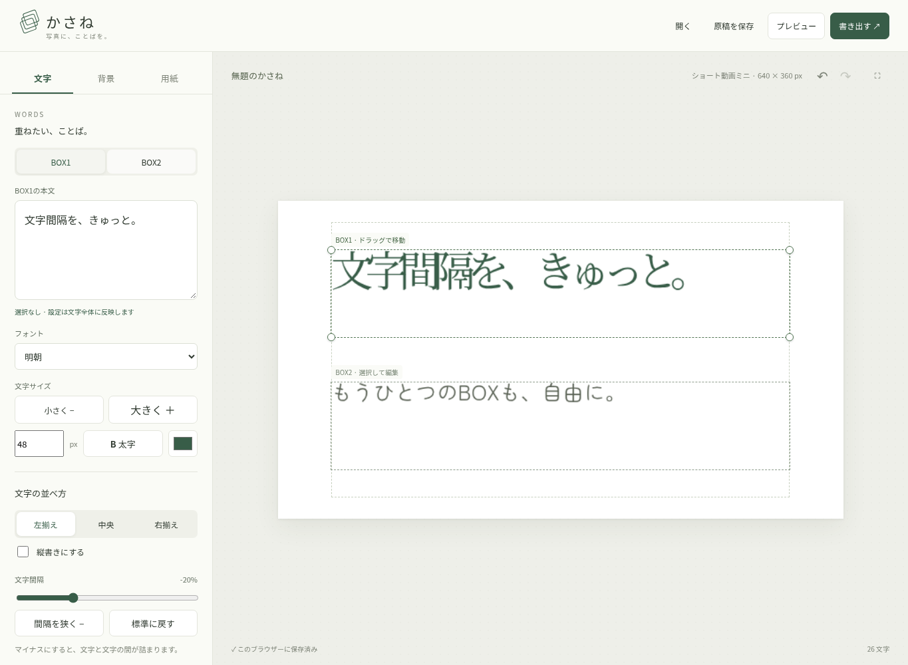
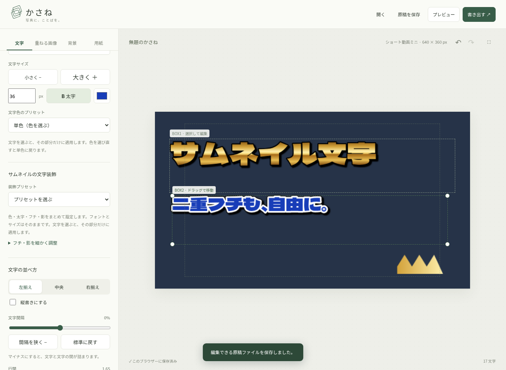
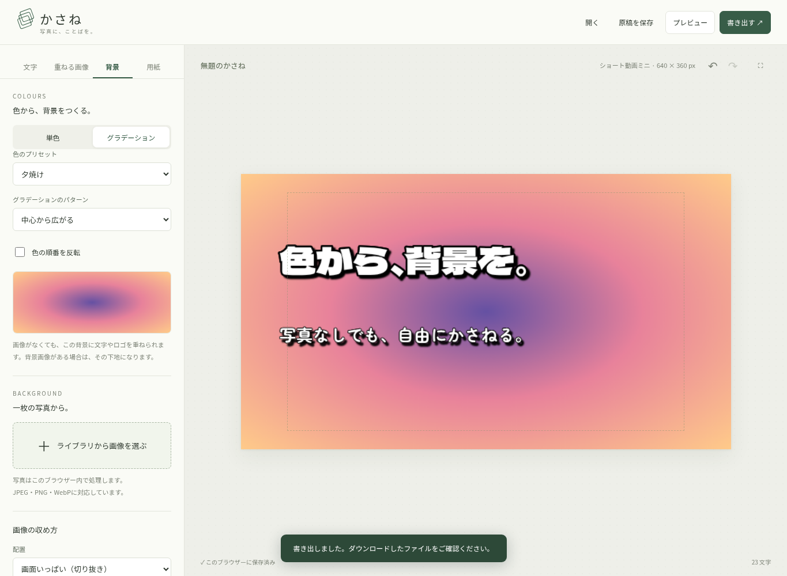
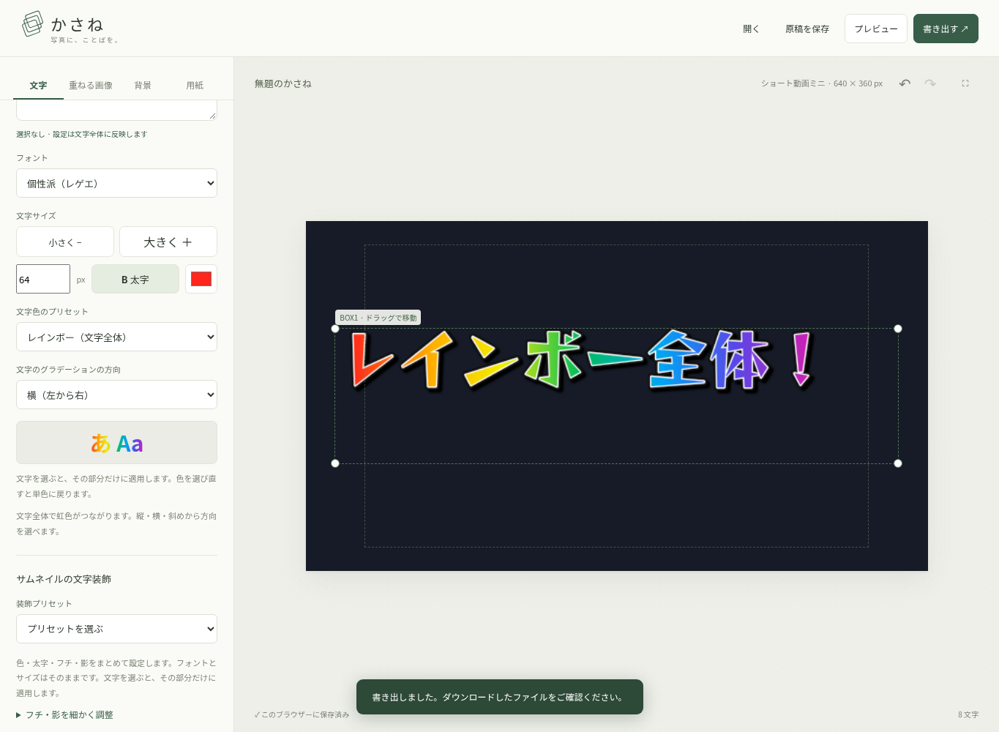
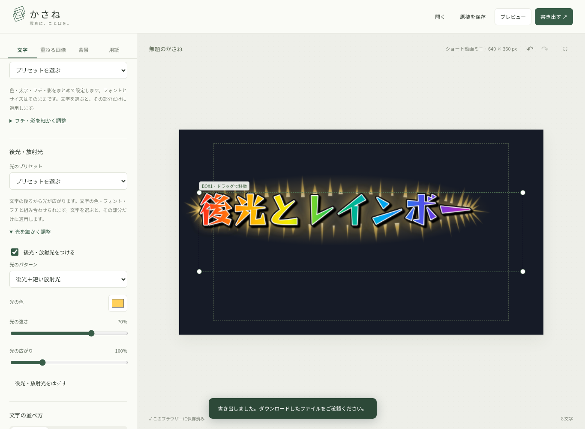
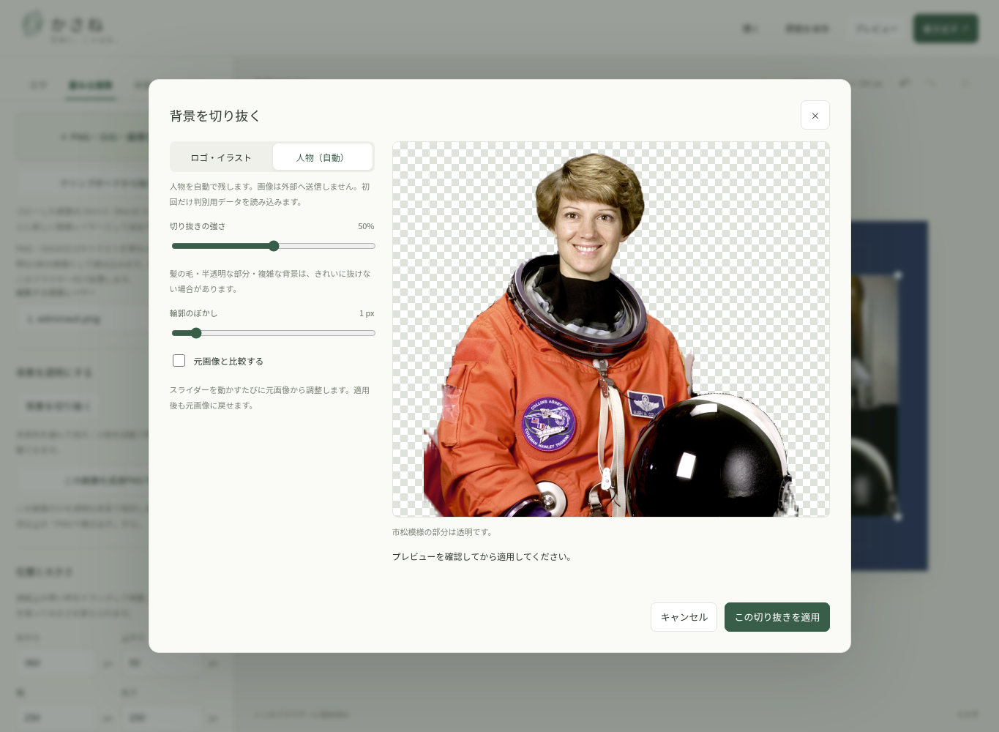
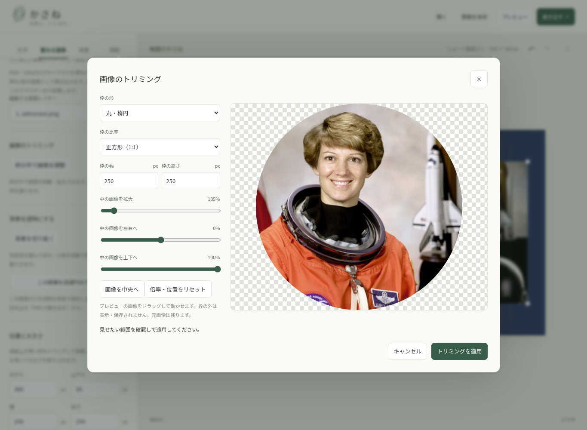
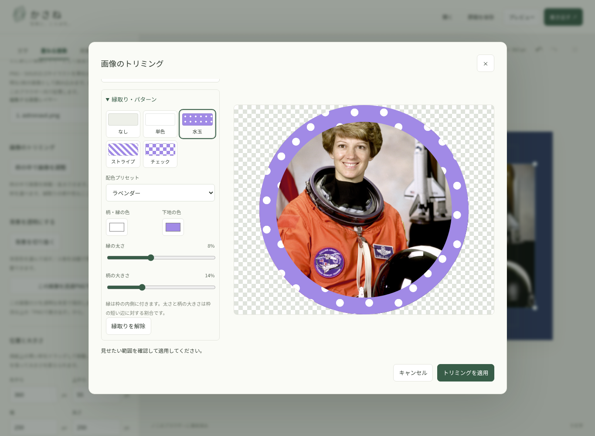

# かさね

写真に、ことばを。A4や動画用のサイズに背景画像と文字を重ねて、PNG・PDFに保存するブラウザーアプリです。

## 使い方

「背景」タブの「色から、背景をつくる」で、背景画像なしでも単色やグラデーションを設定できます。単色は色の候補またはカラーピッカーで選びます。グラデーションは空色・海・夕焼け・さくら・ミント・夜空・ゴールド・シルバーの8種類の色と、縦・横・左右の斜め・中心から広がる・中央で折り返す・繰り返す帯の7パターンを組み合わせ、色の順番も反転できます。文字・ロゴの下に描画され、PNG・PDFと原稿に保存されます。背景画像を使う場合はその下地にもなり、不透明度を下げると透けて見えます。「用紙」の単色設定も同じ背景色に連動します。

フォントは10種類です。従来の角ゴシック・明朝・丸ゴシック・教科書風に、手書き（Yomogi）・筆文字（Yuji Syuku）・ポップ（Hachi Maru Pop）・極太ゴシック（Dela Gothic One）・飾り明朝（Kaisei Decol）・個性派（Reggae One）を追加しています。

「サムネイルの文字装飾」では、くっきりした縁取り・二重フチ・文字の影を個別に設定できます。白文字＋黒フチ、黄色＋黒フチ、青＋白黒二重フチ、ピンク＋黒白二重フチ、赤＋白フチ・光彩、ゴールド＋黒フチに、レインボー全体＋白黒二重フチを加えた7種類のプリセットもあります。フォントや文字サイズを保ち、選択した文字だけにも適用できます。「フチ・影を細かく調整」を開くと、フチの色・太さや影の位置・ぼかしを変更できます。縁取り・影はPNG・PDFに直接描画され、原稿にも保存されます。

「文字」→「後光・放射光」には、金色・白・ピンク・青の光のプリセットがあります。文字色・フチ・フォントを保ったまま、文字の後ろに後光と短い放射光を追加します。「光を細かく調整」で、後光＋放射光／後光だけ／放射光だけ、色、強さ、広がりを調整できます。選択範囲だけにも適用でき、BOXごとに設定でき、文字を動かすと光も一緒に動きます。原稿・PNG・PDFに保存されます。放射光の形は固定され、プレビューと書き出しで変わりません。

「文字色のプリセット」の「レインボー（文字全体）」は、文字列全体にひと続きの虹色をかけます。ゴールドなどを含む全グラデーションで、縦・横・左右の斜めの4方向を選べます。初期設定では実際の文字の幅に合わせて左から右へ変化し、縦書きでは上から下へ変化します。選択した文字だけに適用した場合は、その範囲全体で虹色になります。文字枠の移動や文字間隔の変更にも追従し、二重フチ・影と組み合わせられます。従来の「レインボー（1文字ずつ）」も選べます。

「文字色のプリセット」ではゴールド・シャンパンゴールド・ローズゴールド・シルバー・レインボーのグラデーションを選べます。文字の選択範囲やBOXごとに設定でき、太字・glow・縦書きにも対応します。PNG・PDFと原稿ファイルに反映されます。色の選択や「単色」で通常の文字色に戻せます。

画像をコピーして **Ctrl＋V**（Macは **⌘＋V**）を押すか、「重ねる画像」の「クリップボードから貼り付け」で、1枚ごとに独立した画像レイヤーとして追加できます。ブラウザーから確認が出たら貼り付けを許可してください。文字入力欄に文字と画像の両方を含む内容を貼り付けた場合は、文字を優先します。画像だけの貼り付けは文字欄からでも画像として追加します。貼り付けた画像も移動・拡大縮小、取り消し、原稿保存、PNG・PDF書き出しに対応しています。

「重ねる画像」タブの「PNG・SVG・画像を追加」からロゴやイラストを最大12枚追加できます。SVGもレイヤーを分解せず、透明部分を保って長辺2048 px以内のPNG画像に変換して取り込みます。SVG内の文字は端末にないフォントだと代替されるため、見た目をそろえたい場合は文字をパスに変換してください。HTMLを埋め込んだSVGには対応していません。透明部分を保ち、青い枠のドラッグ・四隅のハンドルで移動と縦横比を保った拡大縮小ができます。数値でも調整でき、選択リストで編集する画像を切り替えます。不透明度、文字の手前／奥、画像同士の重なり順、中央配置、削除に対応しています。操作は「元に戻す」で取り消せます。画像も自動保存・原稿ファイル・PNG・PDFに含まれます。背景写真は「背景」タブで別に設定できます。

1. 「文字」タブの本文欄に入力します。「空のBOX2を追加」で2つ目を作るか、「BOX1をコピー」で本文・文字装飾・文字間隔・枠の大きさを複製できます。コピーした枠は見分けやすいよう位置をずらして配置します。BOX1・BOX2のボタンや用紙上の枠を選んで編集するボックスを切り替えます。文字を選択すると、フォント・サイズ・太字・色・glowをその部分だけ変更できます。選択がなければ選択中のボックス全体に適用します。
2. 「背景」から写真を選びます。収め方、不透明度、拡大、位置を調整できます。背景タブでは用紙上のドラッグ・2本指のピンチも使えます。
3. 「文字」タブで用紙上の緑の文字枠をドラッグして移動し、四隅の丸で幅・高さを変えます。数値で位置とサイズを調整することもできます。「用紙」の「サイズ」でA4、YouTube横動画、ショート動画、ショート動画ミニを選びます。A4は縦横を変更できます。初期値は白紙・黒文字、文字枠は140×100 mmです。
4. 「書き出す」で仕上がりを確認して、PNGまたはPDFを保存します。ファイル名には端末の現地時刻で保存日時を付けます（例：`春の便り_2026-10-20_14-30-45.png`）。編集用の `.kasane` 原稿も同じ形式です。余白ガイドは出力されません。

BOX2を選ぶと「左端をBOX1にそろえる」で、上下の位置・枠の大きさを保ったまま左端を整列できます。用紙からはみ出す場合はBOX2の幅を小さくしてください。整列は「元に戻す」で取り消せます。

BOX2を選ぶと「BOX2を削除」ボタンが表示されます。削除後はBOX1の編集に戻り、「元に戻す」でBOX2を復元できます。空のBOX2の追加・コピーもやり直せます。

文字間隔は「文字の並べ方」のスライダーまたは「間隔を狭く −」ボタンで調整できます。0%が標準、マイナスにすると文字間が詰まります（−50%〜＋50%）。横書き・縦書きの両方に対応し、各BOXで文章、書式、文字間隔、行間、文字揃え、縦書き、位置・大きさを個別に設定できます。PNG・PDFには両方のBOXが出力され、自動保存・原稿ファイルにも両方が残ります。

以前の1ボックスの原稿は、標準の文字間隔で元の配置を保ったまま開けます。「文字枠の位置と大きさ」の「小さな枠にする」で縮めてから移動できます。文字枠の位置と大きさは自動保存・原稿ファイル・PNG・PDFに反映されます。用紙タブで余白を変更すると、文字枠を余白の内側いっぱいに戻します。編集用の枠とハンドルは出力されません。枠にフォーカスして矢印キーで1 mm、Shift＋矢印キーで5 mmずつ移動できます。

「大きく／小さく」は選択範囲を保持して即時反映します。文字サイズの数字は入力欄を離れるかEnterで反映し、本文に改行を挿入しません。縦書きは右列から左列へ進み、上・中央・下揃えに対応します。

原稿はIndexedDBに自動保存します。ブラウザーのデータを消すと失われるので、大切な原稿は「原稿を保存」で `.kasane` ファイルとして保存してください。「開く」で画像・文字装飾ごと再編集できます。同時に複数タブで編集する場合、自動保存は最後に保存したタブが優先されます。

写真や原稿をサーバーに送る機能はありません。フォントもアプリに同梱しています。JPEG・PNG・WebPに対応し、背景写真は長辺4096 px、重ねる画像は長辺2048 pxを上限に縮小して端末のメモリー負荷を抑えます。HEICは写真アプリ等でJPEGに変換してから選んでください。

## 開発

Node.js 24 / npm。APIキー・データベース・外部サービスは不要です。

```sh
cd /workspace/gazou-moji
npm ci
npm run dev -- --port 5173
```

通常の端末ではリポジトリのディレクトリで実行してください。

```sh
npm run build       # dist/ に静的サイトを生成
npm run preview     # ビルド済みサイトを確認
npm test            # Chromiumで編集・保存・書き出し・タッチ操作を検証
```

テストは `/usr/bin/chromium` を使用します。別の場所にある場合は `CHROMIUM_PATH` に実行ファイルのパスを指定してください。テスト設定は開発サーバーを必要に応じて起動します。

## 書き出しと文字組み

プレビューと書き出しは同じCanvas描画処理を使い、光彩も直接ピクセルに描き込みます。PNGは300 dpiの解像度情報付きです。

| サイズ | PNGの幅 × 高さ | 縦横比 |
| --- | --- | --- |
| A4 縦／横 | 2480×3508／3508×2480 px | A4 |
| YouTube 横動画 | 1920×1080 px | 16:9 |
| ショート動画 | 1080×1920 px | 9:16 |
| ショート動画ミニ | 640×360 px | 16:9 |

ミニはショートの幅・高さをそれぞれ3分の1にして、縦横を入れ替えた横長サイズです。YouTube横動画とミニの間では、文字と背景の構成を保って縮小・拡大します。以前の縦長ミニの原稿も、本文と画像を保って横長に読み替えます。動画用のサイズでは文字サイズと文字枠の位置・大きさをpxで調整できます。A4では文字サイズはpt、文字枠はmmです。サイズを切り替えると文字枠と背景位置も用紙の比率に合わせて調整します。

PDFは選んだサイズ・縦横比の1ページに同じ画像を配置します。PDF内の文字は画像なので、テキスト検索や文字選択はできません。

角ゴシック（Noto Sans JP）、明朝（Noto Serif JP）、丸ゴシック（Zen Maru Gothic）、教科書風（Klee One）を同梱。上記の追加6書体も同梱しています。Klee Oneは教科書に近い手書き調の代替書体です。書体ライセンスは各npmパッケージのOFLを参照してください。

用紙は1ページ、文字ボックスは最大2つ、本文は各BOXで最大30,000 UTF-16コード単位です。収まらないときは警告を出します。自動改ページ・ルビ・縦中横・厳密な和文組版には対応していません。半角英数字は縦書きで一文字ずつ横向きになります。文字装飾の確認は用紙上のプレビューを使います（本文入力欄は装飾を表示しません）。

Chromiumのデスクトップ・タッチエミュレーションで検証しています。iPad実機のSafari、写真選択、ファイル保存の操作は実機での確認が必要です。

## 公開

`npm run build` の `dist/` を静的ホスティングに配置できます。アプリのWeb公開とGitHubへのプッシュはこのリポジトリを作成しただけでは行われません。

## ビルド済みファイルから公開する

`gh-pages` ブランチには、依存パッケージの取得やビルドが不要な静的ファイル一式を保存しています。サブフォルダー配下でも動くよう `npm run build -- --base=./` で生成し、画面表示とPNG・PDF保存を確認しています。`main` は編集用ソースです。

GitHub Pagesを使う場合は、リポジトリの **Settings → Pages** で **Deploy from a branch** を選び、ブランチを **gh-pages**、フォルダーを **/ (root)** にして保存します。GitHubがデプロイを完了すると、この設定画面に公開URLが表示されます。環境のスナップショット公開とは別の操作です。

Sitesに静的サイトの取り込み機能がある場合は、同じ `gh-pages` ブランチのルートを公開対象にできます。Sitesの公開操作自体はSitesが使えるチャットで行う必要があります。












## 取り込んだ画像の背景を切り抜く

「重ねる画像」で画像を追加・選択し、「背景を切り抜く」を開きます。

- **ロゴ・イラスト**：消す背景色を選ぶか、プレビューから色を拾います。「消す色の範囲」「輪郭のぼかし」を調整できます。「画像の端につながる色だけ消す」をオンにすると、ロゴ内部の同じ色を残せます。
- **人物（自動）**：人物写真の背景を自動で透明にします。「切り抜きの強さ」と「輪郭のぼかし」で調整できます。初回のみ判別用データを読み込み、画像の処理はブラウザー内で行います。写真は外部へ送信しません。髪や半透明な部分、複雑な背景では細部が欠けることがあります。人物以外の自動切り抜きには対応していません。

市松模様が透明な部分です。「元画像と比較する」で確認してから適用します。調整は毎回元画像から行い、「元画像に戻す」で切り抜きを解除できます。元画像と設定は原稿保存・自動保存にも含まれます。

「この画像を透過PNGで保存」は選択した画像だけを透明な背景で保存します。トリミングは反映します。位置・用紙・他のレイヤー・画像の不透明度の設定は含めません。用紙全体のPNG・PDFには、切り抜き後の画像が用紙の背景や他のレイヤーと合成されます。

人物判別にはApache-2.0ライセンスのMediaPipe Selfie Segmentationを使用しています（`public/licenses/MediaPipe.txt`）。`npm run dev` / `npm run build` の前処理で、npmパッケージから必要な判別用ファイルを `public/vendor/` にコピーします。公開時にも同じサイトから読み込むため、外部CDNは不要です。




## 画像のトリミング（クリッピングマスク）

「重ねる画像」で対象の画像を選び、「枠の中で画像を調整」を開きます。枠の幅・高さや比率、四角・角丸・丸／楕円の形を指定し、枠の中の画像をドラッグ、または位置・倍率スライダーで調整します。画像は縦横比を保ち、枠を覆う大きさから拡大できます。枠の外は表示・保存しません。

「トリミングを適用」の後も、同じボタンから再調整できます。「トリミングを解除」で元画像全体の表示に戻します。元画像は変更せず、枠と倍率・位置は原稿保存・自動保存に含めます。背景の切り抜きとも組み合わせられます。

トリミング中の画像レイヤーは、サイドパネルの幅・高さを別々に変更して枠の比率を調整できます。用紙上の青枠は画像レイヤー全体の移動・拡大縮小に使い、枠の中の画像だけを動かす場合はトリミング画面を開きます。

用紙全体のPNG・PDFと「この画像を透過PNGで保存」に同じトリミングを反映します。画像単体のPNGは枠の外を透明にし、元画像の解像度に応じた大きさで保存します。



## 画像の縁取りパターン

「重ねる画像」→「枠の中で画像を調整」→「縁取り・パターン」を開きます。「単色・水玉・ストライプ・チェック」の4種類から選び、柄・縁の色、下地の色、縁の太さ、柄の大きさを調整できます。ラベンダー・ピンク・ミント・ゴールド・ネイビー・モノクロの配色プリセットもあります。

四角・角丸・丸／楕円の形に沿って、枠の内側に縁を描きます。枠の位置・大きさは変わりません。太さ（0〜20%）と柄の大きさ（2〜40%）は枠の短い辺に対する割合で、画像レイヤーを拡大・縮小すると柄も同じ比率で変化します。太い縁は画像の端を覆います。

元画像を変更せず、設定を画像レイヤーごとに保存します。キャンセルで変更を取り消せ、「なし」または「縁取りを解除」で装飾だけを外せます。元に戻す・やり直す、原稿保存・自動保存に対応し、用紙全体のPNG・PDFと画像単体の透過PNGにも同じ縁取りを反映します。


